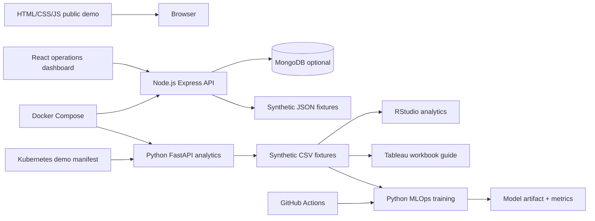

# High-level architecture

The frontend and Node API have a real integration. The static website is intentionally independent for GitHub Pages. The SQL schema and R/Tableau notebooks are companion analytics examples, not falsely depicted as live integrated EHR components. MongoDB is optional and must be seeded using `backend/seed.js` (run `cd backend && npm install && node seed.js`). For the simplest demo, leave `MONGO_URI` unset and use JSON fixtures.

No live interoperability, FHIR feed, patient identity integration, or production security posture is claimed.
